### About me

Hola! I'm **Mau** -- a Forward Deployed Software Engineer at [Palo Alto Collaboration Co.](https://www.paloaltocollaboration.com/) based in Querétaro, Mexico. I build AI-powered systems and work alongside autonomous agents to ship software for startups.

I'm obsessed with AI-augmented development. My daily workflow runs on **Claude Code**, **Pi** and [Pana](https://heypana.ai/) -- Pana is where Alfred lives, the assistant you'll meet in the banner, tea tray included. I genuinely believe the future of software engineering is humans and AI building together, and I'm already living it.

Outside of code, I'm a **DJ** who loves mixing music and a **video game preservation** advocate -- I think games are art and culture worth saving.

### Save slots

<!-- cartridges:start -->

<!-- cartridges:end -->

 

Every widget here is a hand-rolled animated SVG, re-rendered hourly by a GitHub Action from the GitHub GraphQL API — private contributions included, no third-party stat services. Art: 1-bit Bayer dither.
